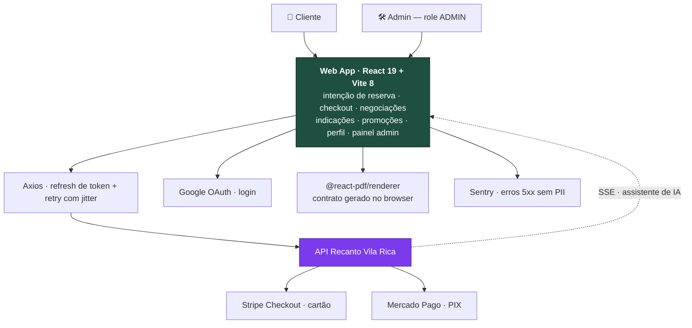

<div align="center">

<h1>🌿 Recanto Vila Rica — Web App</h1>

<p><strong>Interface de reservas de um espaço de eventos: o cliente escolhe a data, assina o contrato e paga; o dono administra a agenda</strong></p>

<p>
  
  &nbsp;
  
  
  
  
  
  
</p>

</div>

---

## O que é

Alugar um espaço para casamento ou aniversário costuma ser um vaivém de WhatsApp: o cliente pergunta se o sábado está livre, o dono confere numa agenda de papel, manda o valor por mensagem, envia o contrato em PDF por e-mail e combina o pagamento por transferência. Ninguém sabe ao certo o que foi acertado, e o "sinal pago" mora num print de comprovante.

Este é o frontend que fecha esse ciclo dentro de uma tela só. O **cliente** abre o calendário e vê o que está ocupado, bloqueado ou livre; escolhe uma das três modalidades (Promocional, Essencial ou Completa), define horário e horas de monitor da área kids; recebe a cotação recalculada pela API enquanto ainda mexe no formulário; lê e baixa o contrato gerado em PDF no navegador; aceita os termos e paga com cartão (Stripe) ou PIX (Mercado Pago) — com QR Code na própria página. Se o pacote padrão não serve, ele abre uma **negociação**: um chat com o administrador que termina numa proposta de preço e datas customizadas, e que, aceita, vira reserva automaticamente. O **administrador** entra na mesma aplicação com `role: ADMIN` e ganha um painel de **9 abas** — dashboard, reservas, usuários, negociações, campanhas, feriados, datas bloqueadas, planos e espaços.

A aplicação são **20 rotas** sobre React 19 + Vite 8, todas as páginas em chunks lazy, cobertas por **552 testes** que rodam em CI a cada push. Nenhum estado de negócio vive aqui: preço, disponibilidade e reembolso são decididos pela API — o front desenha, valida a entrada e nunca é a fonte da verdade.



---

## ✨ Destaques de engenharia

**A fila que impede quatro logins simultâneos.** Quando o access token expira, várias requisições estouram 401 ao mesmo tempo. O interceptor do Axios elege a primeira para renovar o token e empilha as demais numa `pendingQueue`; quando o refresh volta, a fila é drenada e cada request é reenviada com o token novo — um refresh, não quatro. Se o refresh falha, a fila inteira é rejeitada, a sessão é limpa e o usuário vai para `/login`. Endpoints `/auth/*` são excluídos de propósito: ali um 401 significa senha errada, não sessão vencida.

**Retry com jitter, e só onde é seguro.** GET que falha com 5xx é reenviado até 3× com backoff linear (1 s, 2 s, 3 s) mais um jitter aleatório de até 500 ms — sem o jitter, todos os clientes voltariam no mesmo milissegundo e derrubariam o backend outra vez assim que ele levantasse. POST e PATCH nunca são retentados (ninguém quer duas reservas), 429 é rejeitado na hora em vez de insistir contra um rate limit, e em ambiente de teste o retry é desligado para a suíte não esperar 6 segundos por um caso de erro.

**O Sentry que não sabe quem é o usuário.** `beforeSend` descarta todo erro com status < 500 — 401 e 404 são fluxo normal, não incidente — e, no que sobra, apaga os headers `Authorization`/`Cookie` e o `request.data` inteiro, porque o body de um login carrega senha. O contexto de usuário é só `{ id }`: nome e e-mail nunca sobem. Source maps são enviados no build apenas quando `SENTRY_AUTH_TOKEN` existe, então o build local não fala com serviço externo.

**Cotação com debounce e AbortController.** Mudar plano, data, horário ou horas de monitor dispara `POST /reservations/quote`, mas só 600 ms depois da última tecla; a requisição anterior é abortada. O usuário arrasta o horário e vê o preço acompanhar, sem uma requisição por keystroke nem resposta velha sobrescrevendo a nova.

**Contrato em PDF isolado do bundle.** `@react-pdf/renderer` é pesado e só interessa a quem chega na intenção de reserva. O `PDFDownloadLink` vive num arquivo próprio (`ContratoRVR/DownloadLink.tsx`) para a biblioteca cair num chunk lazy — quem só faz login nunca baixa esse código. O contrato é montado com os dados reais da reserva (locatário, data, horário, plano, piscina, área kids, total) e renderizado no navegador, sem round-trip ao servidor.

**Polling de PIX que sabe desistir.** Enquanto o QR Code está na tela, o status é consultado a cada 7 s — e o loop tem três saídas: expiração do código, 5 erros consecutivos (aí avisa e manda conferir em "Minhas reservas") ou status final. Recarregar a página não perde o PIX: se a reserva ainda tem `pixQrCode` válido e não expirado, o QR volta do próprio payload da reserva.

**Guards separados por responsabilidade.** `PrivateRoute` só pergunta se há sessão; `AdminRoute` só pergunta se `role === "ADMIN"` — e é aninhado dentro do primeiro, então autenticação e autorização compõem em vez de duplicar. Ambos leem o `AuthContext`, nunca o `localStorage` direto, o que mantém uma única fonte de verdade e torna os dois testáveis sem mexer em storage.

**Sessão com migração de formato embutida.** O app já gravou a sessão em formato plano (`{ id, name, token }`) antes de normalizar para `{ user, token, refreshToken }`. `readSession()` detecta o formato legado, converte e regrava — usuários com o storage antigo não são deslogados por uma refatoração.

---

## 🔐 Perfis de acesso

<table>
  <thead>
    <tr><th>Perfil</th><th>O que acessa</th></tr>
  </thead>
  <tbody>
    <tr><td><strong>Visitante</strong></td><td>Cadastro, login (e-mail/senha ou Google), recuperação e redefinição de senha</td></tr>
    <tr><td><strong>Cliente</strong></td><td>Home, salões, calendário de disponibilidade, intenção de reserva com cotação e contrato, checkout (cartão/PIX), minhas reservas com cancelamento, negociações, promoções, indicações, contato e perfil</td></tr>
    <tr><td><strong>Admin</strong></td><td>Tudo do cliente + <code>/admin</code>, com 9 abas: dashboard, reservas, usuários, negociações (propostas e reservas customizadas), campanhas (indicação, fidelidade e sorteio VIP), feriados, datas bloqueadas, planos e espaços</td></tr>
  </tbody>
</table>

---

## 💸 Modalidades e reembolso

Os planos e a tabela de reembolso são espelhados em `src/constants/reservation.ts` para a interface bloquear escolhas inválidas antes da API responder:

| Plano | Dias | Valor base |
|---|---|---|
| Promocional | Segunda a quinta (sem feriados) | R$ 650,00 |
| Essencial | Sexta a domingo e feriados | R$ 850,00 |
| Completa | Sexta a domingo e feriados | R$ 1.000,00 |

O front conhece os feriados nacionais fixos e os móveis mapeados até 2027, então o plano Promocional se fecha sozinho num sábado ou num Carnaval — com a mensagem explicando qual plano escolher, em vez de um erro genérico depois do submit.

O cancelamento devolve conforme a distância até o evento — **100%** acima de 180 dias, **70%** de 121 a 180, **40%** de 61 a 120 e **0%** nos últimos 60 dias. Quem calcula e estorna é a API; a interface só mostra o que o cliente vai receber antes de ele confirmar.

---

## 🛠️ Stack

<table>
  <tbody>
    <tr>
      <td><strong>Core</strong></td>
      <td>  (strict) </td>
    </tr>
    <tr>
      <td><strong>UI</strong></td>
      <td>    — tema claro/escuro via <code>data-theme</code></td>
    </tr>
    <tr>
      <td><strong>Rotas & estado</strong></td>
      <td> Context API (<code>AuthContext</code>, <code>ThemeContext</code>) + hooks próprios</td>
    </tr>
    <tr>
      <td><strong>HTTP</strong></td>
      <td> — refresh de token em fila, retry com jitter, AbortController</td>
    </tr>
    <tr>
      <td><strong>Auth</strong></td>
      <td>  (<code>@react-oauth/google</code>)</td>
    </tr>
    <tr>
      <td><strong>Pagamentos</strong></td>
      <td>  — orquestrados pela API</td>
    </tr>
    <tr>
      <td><strong>Documentos</strong></td>
      <td> </td>
    </tr>
    <tr>
      <td><strong>Observabilidade</strong></td>
      <td> + <code>@sentry/vite-plugin</code> (source maps) — sem PII</td>
    </tr>
    <tr>
      <td><strong>Qualidade</strong></td>
      <td>    </td>
    </tr>
    <tr>
      <td><strong>CI/CD</strong></td>
      <td>   — deploy a cada push em <code>main</code></td>
    </tr>
  </tbody>
</table>

---

## 🚀 Rodando localmente

### Pré-requisitos

| Requisito | Versão | Observação |
|---|---|---|
| **Node.js** | **20.x** | versão usada em todos os jobs do CI (`.github/workflows/ci.yml`) |
| **npm** | 10+ | acompanha o Node 20; o projeto usa `package-lock.json` |
| **API do Recanto Vila Rica** | — | precisa estar rodando — repositório `recanto-vila-rica-api` (privado, código de cliente) |

> Sem a API no ar a aplicação abre, mas login, salões e reservas falham — todo dado vem dela.

### Passo a passo

```bash
# 1. Clone e instale
git clone https://github.com/mateus-vitor-ferreira-dev/recanto-vila-rica-web.git
cd recanto-vila-rica-web
npm install

# 2. Suba a API primeiro (noutro terminal), em http://localhost:3000

# 3. Crie o .env.local na raiz — o repo não versiona .env (veja as variáveis abaixo).
#    Dá para pular: sem nenhuma variável, VITE_API_URL cai no default http://localhost:3000
touch .env.local

# 4. Rode
npm run dev                     # http://localhost:5173
```

### Variáveis de ambiente

O Vite só expõe ao browser variáveis com o prefixo `VITE_`. Todas são lidas em um único lugar — `src/config/env.ts` — e **as três são opcionais**: nenhuma derruba o boot.

```ini
# URL base da API. É a única que você provavelmente vai querer definir.
# Opcional — sem ela o código usa http://localhost:3000 (default em src/config/env.ts).
VITE_API_URL=http://localhost:3000

# Client ID do Google OAuth — habilita o botão "Entrar com Google".
# Opcional em dev: sem ela o botão renderiza mas o login com Google não completa;
# login por e-mail/senha continua funcionando normalmente.
# Como obter: Google Cloud Console → APIs e Serviços → Credenciais →
#   Criar credencial → ID do cliente OAuth → Aplicativo da Web →
#   adicione http://localhost:5173 em "Origens JavaScript autorizadas".
VITE_GOOGLE_CLIENT_ID=

# DSN do Sentry. Opcional — vazia desliga o Sentry por completo
# (initSentry() retorna cedo, nenhum evento é enviado). Deixe vazia em dev.
# Como obter: sentry.io → Settings → Projects → [projeto] → Client Keys (DSN).
VITE_SENTRY_DSN=
```

Há ainda uma variável de **build**, lida via `process.env` no `vite.config.ts` — nunca chega ao browser:

```ini
# Token do Sentry para upload de source maps no build de produção.
# Opcional: sem ela o sentryVitePlugin roda em modo silencioso e não sobe nada.
# Usada apenas em CI/Vercel — não precisa localmente.
SENTRY_AUTH_TOKEN=
```

> `.env` e `.env.*` estão no `.gitignore`. Nunca commite nenhum deles — as chaves reais vivem na Vercel e nos secrets do GitHub.

### Endereços locais

| O quê | URL | Origem |
|---|---|---|
| Web app | `http://localhost:5173` | `server.port` no `vite.config.ts` (`strictPort: true`) |
| API esperada | `http://localhost:3000` | default de `VITE_API_URL` |
| Storybook | `http://localhost:6006` | `npm run storybook` |
| Preview do build | `http://localhost:4173` | `npm run preview` (default do Vite) |

### Como verificar que subiu

1. Abra `http://localhost:5173` — a intro animada roda e você cai em `/cadastro` (a raiz `/` redireciona para lá).
2. Crie uma conta ou faça login: se a lista de salões carregar em `/venues`, o front está falando com a API.
3. Não carregou? Abra o DevTools → Network e confira para qual host as chamadas estão indo — é o valor efetivo de `VITE_API_URL`.

### Problemas comuns

| Sintoma | Causa provável |
|---|---|
| Vite não sobe: "Port 5173 is already in use" | `strictPort: true` faz o Vite falhar em vez de pular para outra porta — libere a 5173 (o app depende dela para o OAuth e o CORS da API baterem). |
| Mudou o `.env.local` e nada aconteceu | Variáveis `VITE_*` são inlined no build. Reinicie o `npm run dev` — HMR não recarrega env. |
| Erros de CORS em toda chamada | A API precisa liberar `http://localhost:5173` como origem. Confira a config de CORS no repo da API. |
| Login com Google abre o popup e ele fecha sozinho | Falta o header `Cross-Origin-Opener-Policy: same-origin-allow-popups`. O `vite.config.ts` já o define em dev e o `vercel.json` em produção — se você serve o build por outro meio, replique-o. |
| `VITE_GOOGLE_CLIENT_ID` definida mas o Google recusa | `http://localhost:5173` não está nas origens autorizadas do OAuth client. |
| Toda requisição volta 401 e o app desloga | Sessão expirada com refresh token inválido: o interceptor limpa o storage e manda para `/login`. Faça login de novo. |

### Scripts

| Comando | O que faz |
|---|---|
| `npm run dev` | Servidor de desenvolvimento com HMR em `:5173` |
| `npm run build` | Build de produção em `dist/` (com source maps) |
| `npm run preview` | Serve o build de produção localmente |
| `npm run lint` | ESLint em todo o projeto |
| `npm test` | Roda a suíte uma vez (`vitest run`) |
| `npm run test:watch` | Testes em modo watch |
| `npm run test:coverage` | Testes + relatório de cobertura (v8) |
| `npm run storybook` | Storybook em `:6006` |
| `npm run build-storybook` | Build estático do Storybook |

---

## 🧪 Testes

```bash
npm test                # 552 testes em 54 arquivos
npm run test:watch      # modo watch
npm run test:coverage   # cobertura v8 — falha abaixo dos thresholds
```

Os testes rodam em **jsdom** e batem numa API falsa servida por **MSW**, com `onUnhandledRequest: "error"` — nenhuma requisição escapa sem handler declarado, então um endpoint novo esquecido quebra o teste em vez de virar um `undefined` silencioso. Bibliotecas que não fazem sentido em jsdom (GSAP, `@react-pdf/renderer`, `react-datepicker`, Google OAuth) são substituídas por mocks via alias do Vitest, e o retry do Axios se desliga sozinho em ambiente de teste (`env.isTest`) para os casos de erro não esperarem os backoffs reais.

A cobertura tem **thresholds que reprovam o build**: 84% de linhas, 82% de funções e 75% de branches (`vite.config.ts`). Arquivos sem lógica testável — estilos, assets, barris de export e componentes puramente visuais — ficam fora do cálculo, para a métrica medir comportamento e não `export * from`.

**Pipeline** (`.github/workflows/ci.yml`), a cada push em qualquer branch: `lint` → `test` (com cobertura) → `security` (Snyk, falha em vulnerabilidade high/critical) → `build` → `deploy` na Vercel, este último só em push na `main`.

---

<div align="center">
  <sub>
    <a href="https://github.com/mateus-vitor-ferreira-dev/recanto-vila-rica-landing-page">Landing page</a>
  </sub>
</div>
