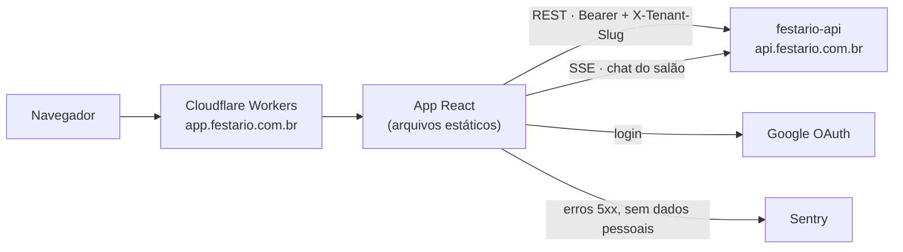

<div align="center">


<h1>Festário — App</h1>

<p><strong>Reserva de salão de festa e contratação dos serviços da festa, num lugar só.</strong></p>

<p>
  <a href="https://festario.com.br">Site</a> ·
  <a href="https://app.festario.com.br">App</a> ·
  <a href="https://api.festario.com.br">API</a>
</p>

<p>
  <a href="https://github.com/mateus-vitor-ferreira-dev/festario-web/actions/workflows/ci.yml"></a>
  <a href="LICENSE"></a>
  
  
  
  
</p>

</div>

---

## Sobre

Reservar um salão de festa ainda é um vaivém de mensagens. O cliente pergunta se a data está livre, o dono confere a agenda, manda valores e contrato por fora, e o pagamento fica num print de comprovante. Depois vem a segunda rodada: buffet, decoração e o resto, cada um num contato diferente.

O Festário junta as duas pontas. Cada salão tem a própria agenda, os próprios pacotes e as próprias regras, e o cliente reserva com uma conta única na plataforma. A partir da reserva, ele encontra prestadores que atendem naquela data e naquele local e pede orçamentos. Este repositório é o app web; as regras de negócio ficam na API.

## Funcionalidades

**Quem organiza a festa (cliente)**
- Vitrine de salões em `/saloes`, com filtros e os mais próximos primeiro (localização por CEP ou GPS); página do salão em `/s/:slug`.
- Reserva com calendário de disponibilidade, pacotes do salão, cotação calculada pela API e prévia do contrato em PDF.
- Pagamento combinado com o salão: a tela "Como pagar" mostra valor, prazo e contatos, com mensagem pronta para o WhatsApp.
- Vitrine de serviços em `/servicos`, com as categorias num carrossel de bandeirinhas (a do meio é o filtro ativo), página do prestador e pedido de orçamento.
- "Meus orçamentos", avaliações de prestadores e "Monte a sua festa" a partir de uma reserva, com os fornecedores indicados pelo salão primeiro.
- Negociações com o salão, promoções, indicações, perfil e o assistente do salão no chat.

**Dono do salão (`OWNER`, em `/painel`)**
- Dashboard, reservas, usuários, negociações, campanhas, feriados e datas bloqueadas.
- Registro de cada pagamento recebido de uma reserva.
- Regras do salão: pacotes, itens, reserva e cláusulas do contrato.
- Marca e fotos (logo e cor do salão), espaços, fornecedores indicados e assinatura por Pix Automático.

**Prestador de serviço ("Meu negócio", em `/meu-negocio`)**
- Painel da conta de cliente que presta serviço: perfil, portfólio, pacotes, agenda, orçamentos recebidos e avaliações.

**Equipe da plataforma (`ADMIN`, em `/plataforma`)**
- Lista de salões com contagens, cadastro e ativação, convites do dono, situação da assinatura e acesso ao painel de cada salão.

O cabeçalho tem duas camadas: na barra fica o uso do dia a dia; o resto fica no menu da conta, no avatar.

## Arquitetura



O app é uma SPA estática: não tem código de servidor. Toda chamada passa por uma instância do Axios (`src/services/api.ts`). Ela envia o token e, quando há um salão guardado no navegador, o cabeçalho `X-Tenant-Slug`; sem ele, a API usa o salão padrão. Quando o access token vence, o interceptor renova a sessão e reenvia a requisição. Se a renovação falha, a sessão é limpa e a pessoa volta para `/login`.

**Sessão sem tokens no `localStorage`.** O access token fica só em memória. O refresh token vive num cookie HttpOnly (`festario_rt`, `Path=/auth`) que o JavaScript não lê; ao abrir a página, o app chama `/auth/refresh` para restaurar a sessão. No `localStorage` fica só um marcador sem segredo dizendo que houve login. Os previews em `*.workers.dev` são outro site em relação à API e não recebem o cookie: lá o token volta no corpo da resposta e fica no `sessionStorage` da aba.

## Destaques de engenharia

- **Fila de refresh de token.** Vários 401 ao mesmo tempo geram um refresh só: as outras requisições esperam numa fila e são reenviadas com o token novo. Rotas `/auth/*` ficam de fora, porque ali 401 é credencial inválida.
- **Retry com jitter, só onde é seguro.** GET com erro 5xx é reenviado até 3 vezes, com espera crescente mais até 500 ms aleatórios. Escritas e 429 nunca são reenviados.
- **Sentry sem dados pessoais.** Erros 4xx são descartados; cabeçalhos de autenticação, cookies e corpo da requisição são removidos; o usuário vai só pelo ID.
- **Páginas sob demanda.** Cada página é um chunk carregado com `React.lazy`, e o gerador de PDF do contrato só é baixado quando usado.
- **Marca do salão sem quebrar o contraste.** A cor do salão vira variáveis CSS usadas só como acento; se a marca não carregar, o app segue com a da plataforma.

## Stack

| Camada | Ferramentas |
|---|---|
| Interface | React 19, React Router 7, styled-components 6, GSAP |
| Linguagem e build | TypeScript 6, Vite 8 |
| Dados | Axios, date-fns |
| Login | Google OAuth (`@react-oauth/google`) |
| PDF | `@react-pdf/renderer` |
| Observabilidade | Sentry |
| Testes | Vitest 4, Testing Library, MSW, jsdom |
| Componentes | Storybook 10 |
| Deploy | Cloudflare Workers (Workers Builds), Wrangler |

## Começando

**Pré-requisitos:** Node.js 20.19 ou mais novo (o CI usa o 20) e a API (`festario-api`, repositório privado) rodando localmente em `http://localhost:3000`.

```bash
git clone https://github.com/mateus-vitor-ferreira-dev/festario-web.git
cd festario-web
npm install
cp .env.example .env.local   # todas as variáveis são opcionais em dev
npm run dev
```

| Endereço | O que é |
|---|---|
| http://localhost:5173 | app (`npm run dev`) |
| http://localhost:3000 | API (padrão de `VITE_API_URL`) |
| http://localhost:6006 | Storybook (`npm run storybook`) |

| Variável | Para que serve |
|---|---|
| `VITE_API_URL` | URL base da API. Padrão: `http://localhost:3000`. |
| `VITE_GOOGLE_CLIENT_ID` | Liga o botão "Entrar com Google". Precisa ser o mesmo ID usado na API. Sem ele, o botão não aparece. |
| `VITE_SENTRY_DSN` | Liga o Sentry. Vazia desliga (deixe vazia em dev). |

`SENTRY_AUTH_TOKEN` só é usado no build de produção, para enviar os source maps ao Sentry. Não chega ao navegador. O Vite só lê o `.env.local` ao subir: depois de mudar, reinicie o `npm run dev`.

## Scripts

| Comando | O que faz |
|---|---|
| `npm run dev` | servidor de desenvolvimento na porta 5173 |
| `npm run build` | build de produção em `dist/` |
| `npm run preview` | serve o build localmente |
| `npm run lint` | ESLint |
| `npm test` | testes uma vez (`vitest run`) |
| `npm run test:watch` | testes em modo watch |
| `npm run test:coverage` | testes com relatório de cobertura |
| `npm run storybook` | Storybook na porta 6006 |
| `npm run build-storybook` | build estático do Storybook |

## Testes e qualidade

- **784 testes** em 81 arquivos, com Vitest, Testing Library e jsdom.
- A API é simulada com **MSW** (`src/tests/mocks`); bibliotecas pesadas (Google OAuth, react-pdf, datepicker) têm mocks próprios.
- Cobertura mínima exigida em `vite.config.ts`: **linhas 84%, funções 82%, branches 75%**. Na medição atual: linhas 89,15%, funções 82,85%, branches 81,56%.
- O CI (`.github/workflows/ci.yml`) roda a cada push: lint, testes com cobertura, análise de dependências com Snyk (falha em severidade alta ou crítica) e build.

## Deploy

O Cloudflare Workers Builds publica o app a cada push na `main`: roda `npm run build` e `npx wrangler deploy`, servindo `dist/` em `app.festario.com.br`. Rotas desconhecidas devolvem o `index.html`, como pede uma SPA. Cada branch ganha um link próprio de preview (`previews` em `wrangler.jsonc`).

## Estrutura do projeto

```
src/
├── components/   # componentes compartilhados (Header, layouts, calendário, marketplace, contrato)
├── config/       # env, sessão, tenant, Sentry
├── contexts/     # autenticação, tema e marca do salão
├── hooks/        # dados, paginação, filtros na URL, localização
├── pages/        # uma pasta por página (Admin = /painel, Platform = /plataforma)
├── routes/       # árvore de rotas e guardas por login e papel
├── services/     # chamadas à API, uma por domínio
├── tests/        # testes e mocks (MSW)
├── types/
└── utils/
docs/marca/       # kit de marca
```

## Marca

Logotipo, símbolo, cores e regras de uso ficam em [`docs/marca`](docs/marca).

## Contribuição

Contribuições são só por convite. Veja o [CONTRIBUTING.md](CONTRIBUTING.md).

## Segurança

Para relatar uma vulnerabilidade de forma privada, siga o [SECURITY.md](SECURITY.md).

## Licença

Software proprietário. Todos os direitos reservados. O código é público para consulta, mas o uso, a cópia e a redistribuição dependem de autorização. Veja [LICENSE](LICENSE).
